# Fuel & Wrench – Brugervejledning

[Deutsch](de.md) · [English](en.md)

Alle billeder viser opdigtede eksempeldata: en dieselstationcar og en motorcykel med sæsonindregistrering. De laves automatisk ved hver ny version.

## Indhold

1. [Køretøjer](#køretøjer)
2. [Oversigt over et køretøj](#oversigt-over-et-køretøj)
3. [Tankning](#tankning)
4. [Service, syn og motorolie](#service-syn-og-motorolie)
5. [Dæk](#dæk)
6. [Omkostninger](#omkostninger)
7. [Statistik og eksport](#statistik-og-eksport)
8. [Datablad](#datablad)
9. [Motorcykel og sæsonindregistrering](#motorcykel-og-sæsonindregistrering)
10. [Påmindelser](#påmindelser)
11. [Brændstofpriser](#brændstofpriser)
12. [Synkronisering](#synkronisering)
13. [Datapleje](#datapleje)
14. [Widget og genveje](#widget-og-genveje)

## Køretøjer

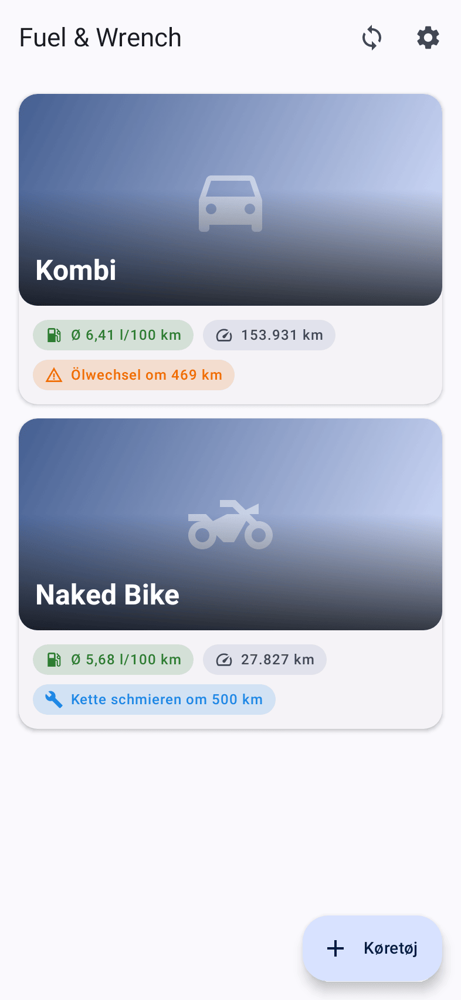

Startsiden viser alle køretøjer med forbrug og seneste tankning. Med **+ Køretøj** opretter du et nyt: navn, type (bil eller motorcykel), brændstof, tankstørrelse og kilometertal ved start er nok. Fotos, enheder (km/mi, l/gal) og valuta kan tilføjes senere.

Et køretøj, du ikke længere kører, kan **arkiveres**: dataene bevares, men det vises ikke længere i påmindelser og valglister.

 

## Oversigt over et køretøj

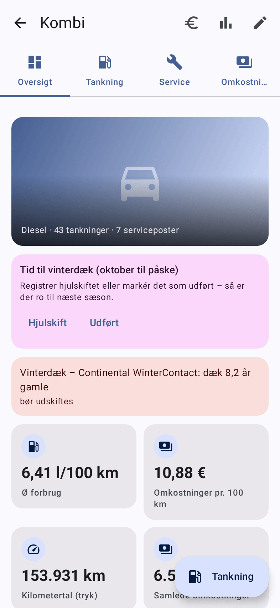

Et køretøj har fire faner: **Oversigt**, **Tankninger**, **Service** og **Omkostninger**. Ikonerne øverst fører til brændstofpriser, statistik og redigering.

Oversigten viser det, der er vigtigt lige nu:

- **Hint** som afvigelser i dataene, det forestående dækskifte (oktober til påske) eller for gamle dæk.
- **Nøgletal**: gennemsnitsforbrug, udgifter pr. 100 km, kilometertal og samlede udgifter.
- **Påmindelser**, f.eks. olieskift eller syn.

 

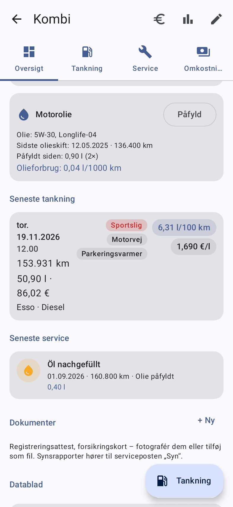

Længere nede:

- **Motorolie**: sidste olieskift, olie påfyldt siden og olieforbrug. Med **Påfyld** registrerer du hurtigt en påfyldning.
- **Dokumenter**: registreringsattest, forsikringskort, typeattest og den aktuelle synsrapport. Tryk for at åbne sidevisningen.
- **Datablad** med de vigtigste oplysninger, se [Datablad](#datablad).

 

## Tankning

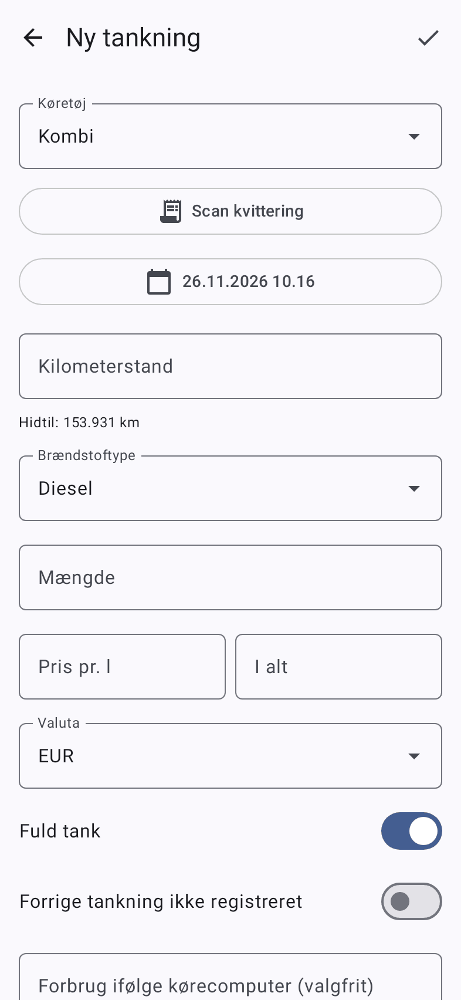

Med **Tankning** (nederst til højre) registrerer du en tankning: kilometertal, mængde og enten pris pr. liter eller beløb i alt. Den anden værdi beregnes.

For et præcist forbrug:

- Slå **Fuld tank** til, når tanken er fuld. Delvise tankninger lægges sammen indtil næste fulde tankning.
- Slå **Forrige tankning ikke registreret** til, hvis du har glemt en, så hullet ikke indgår i gennemsnittet.

**Aktuel position** genkender tankstationen. Det kan slås fra, se privatliv.

 

### Scan kvittering

**Scan kvittering** spørger først om det, der ikke står på kvitteringen: kilometertal, kørestil, strækning og ekstra som aircondition eller parkeringsvarmer. Derefter åbner kameraet. Tekstgenkendelsen kører helt på telefonen og læser mængde, pris, beløb, brændstof, tankstation og dato. Du kontrollerer værdierne og overtager dem.

Hvis det ikke lykkes med det samme, kan du **afgrænse området**. Udsnittet læses så fra originalfotoet i fuld opløsning, hvilket især hjælper ved fotos taget i hånden, hvor kvitteringen kun fylder en del af billedet.

 

### Tankning i udlandet

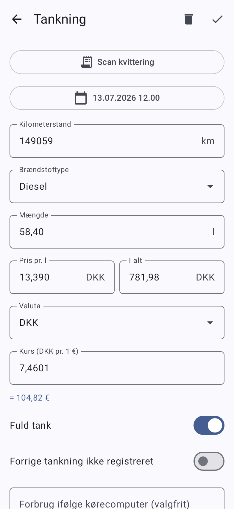

Vælg den lokale **valuta**, f.eks. DKK, og indtast pris og beløb som på kvitteringen. Appen henter Den Europæiske Centralbanks referencekurs for dagen og viser det omregnede beløb. Statistik og udgifter regner med det.

Har din bank brugt en anden kurs, ændrer du den bare. Kvitteringsscanningen genkender valutaen, når den fremgår tydeligt (DKK, SEK, £, zł …). Står der kun “kr”, vælger du den selv.

 

### Liste over tankninger

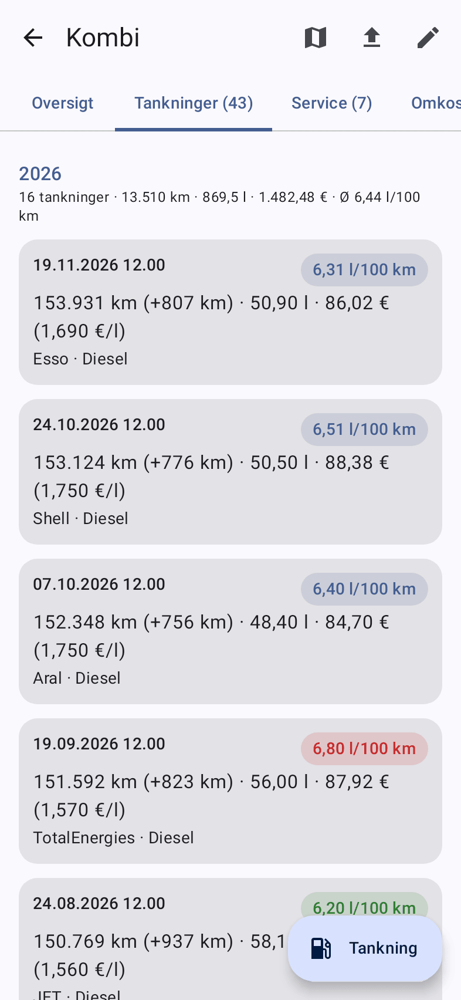

Fanen **Tankninger** viser alle poster grupperet efter år med forbrug og kørt strækning siden forrige tankning. Tryk på en post for at redigere den.

 

## Service, syn og motorolie

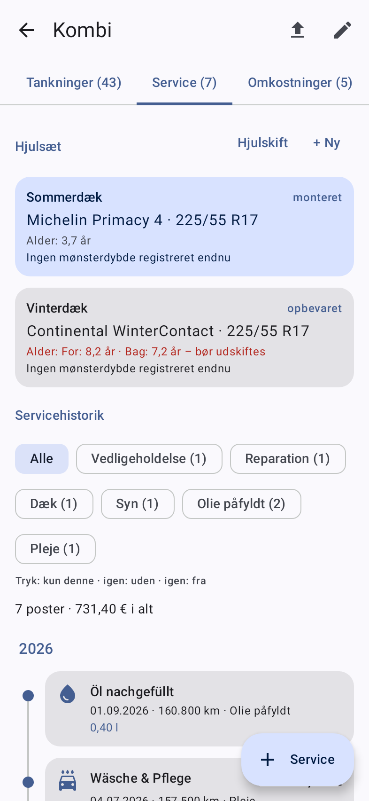

Fanen **Service** viser værksteds- og vedligeholdelseshistorikken. Brug **filtrene** øverst:

- tryk én gang: **kun** denne kategori,
- tryk igen: **uden** denne kategori (rød, overstreget),
- tryk tredje gang: filter fra.

Kategorier kan kombineres, “Alle” nulstiller. Bilag og rapporter vises som små forhåndsvisninger; tryk for at åbne dem direkte.

 

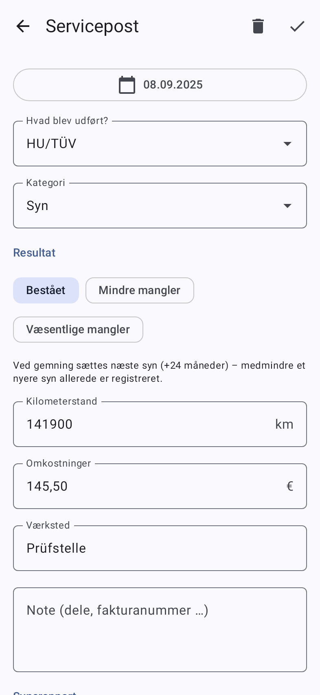

**Syn** er en egen kategori med **resultat** (bestået, mindre mangler, væsentlige mangler) og rapporten som bilag. Ved “bestået” eller “mindre mangler” sættes næste syn automatisk til synsdatoen plus 24 måneder. Ved væsentlige mangler bliver påmindelsen stående til omsynet.

**Olieskift**: vedligeholdelsesposter har kontakten “Olieskift”, som er grundlaget for olieforbruget. **Olie påfyldt** er en egen kategori med mængde. Hurtigst går det via motorolie-kortet i oversigten.

 

## Dæk

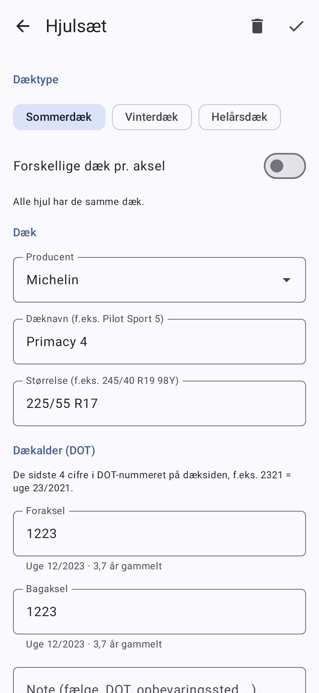

Under **Service** administrerer du dæksæt (sommer, vinter, helår) med mærke, model og størrelse, på motorcykel separat for og bag.

- **Dækalder**: indtast de sidste 4 cifre i DOT-nummeret pr. aksel (f.eks. 2321 = uge 23/2021). Fra 6 år vises et hint, fra 8 år en advarsel.
- **Hjulskift**: en servicepost “Hjulskift” husker, hvilket sæt der er monteret, og om ønsket mønsterdybden.
- **Sæsonpåmindelse**: fra oktober og fra påske minder appen om skiftet, indtil du registrerer det eller trykker “Udført”. Kun ved to sæt og ikke ved helårsdæk.

 

## Omkostninger

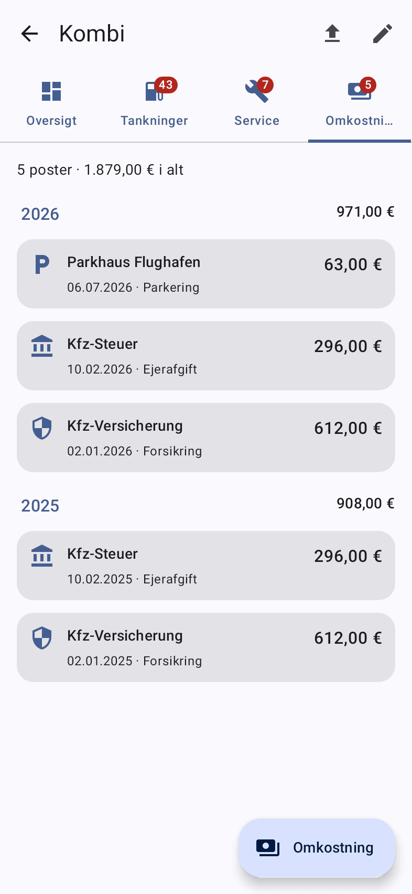

**Omkostninger** rummer alt undtagen brændstof og værksted: forsikring, afgift, parkering, vejafgift, vask osv., hver med bilag som foto eller PDF.

 

## Statistik og eksport

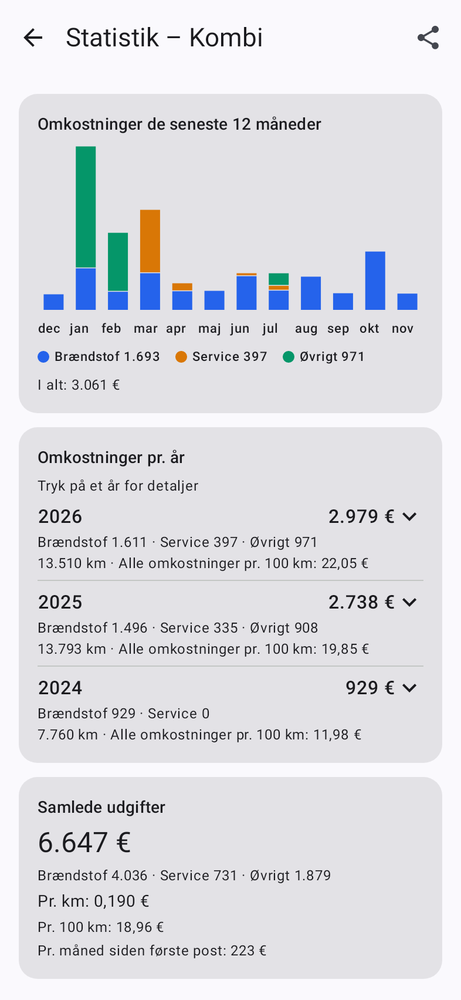

**Statistik** (diagramikonet øverst) viser hvert år med strækning, forbrug og udgifter; tryk på et år for at se månederne. Nedenunder følger forbrugs- og prisgrafer, hvis periode du vælger med knapperne.

Med **del-ikonet** eksporterer du køretøjets tankninger, service og udgifter som CSV-filer, f.eks. til Excel.

 

**Samlede udgifter**: hvad koster køretøjet egentlig? Brændstof, service og øvrige udgifter tilsammen, pr. km, pr. 100 km og pr. måned. Længere nede står oliepåfyldninger pr. år med olieforbrug.

 

## Datablad

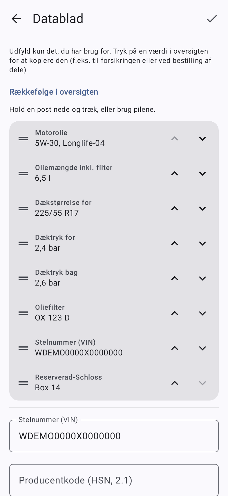

**Databladet** samler det, man altid leder efter: stelnummer, typekoder, olietype og -mængde, filtre, dækstørrelser og -tryk, på motorcykel også kæde, tandhjul og forgaffelolie. Tilføj egne felter efter behov.

I oversigten **kopierer** et tryk værdien, f.eks. til forsikringen eller ved bestilling af dele. **Rækkefølgen** bestemmer du øverst i databladet: hold en post nede og træk, eller brug pilene.

 

## Motorcykel og sæsonindregistrering

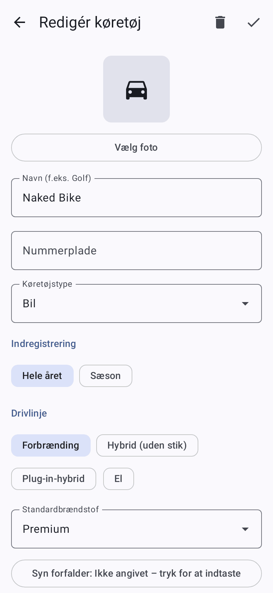

Under **Rediger køretøj → Indregistrering** vælger du “Hele året” eller “Sæson” med måned fra og til, f.eks. marts til oktober. Uden for perioden holder notifikationer og dækpåmindelsen pause; det, der forfalder, vises ved sæsonstart. Oversigten viser status, f.eks. “afmeldt, igen fra marts”.

 

## Påmindelser

Påmindelser fungerer efter kilometer, tid eller begge, f.eks. “olieskift hver 30.000 km eller 2 år”. En notifikation kommer i god tid. En matchende servicepost (samme titel) nulstiller påmindelsen automatisk. Synspåmindelsen opretter du nemmest via **Rediger køretøj → Syn forfalder**.

## Brændstofpriser

Med din egen gratis nøgle fra Tankerkönig (kun Tyskland; Indstillinger → Brændstofpriser) viser appen aktuelle priser i nærheden ud fra din position eller, hvis den ikke er tilgængelig, den seneste tankning.

**Kan omvejen betale sig?** Ved hver tank står, om turen kan betale sig i forhold til den nærmeste, ud fra din sædvanlige tankning, dit forbrug og omvejen frem og tilbage.

## Synkronisering

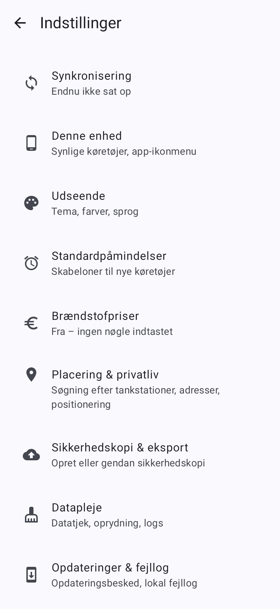

Under **Indstillinger → Synkronisering** forbinder du appen med din egen Nextcloud eller en anden WebDAV-server, helst med en app-adgangskode. Alle enheder, der bruger samme mappe, har de samme data, inklusive fotos og bilag.

Med **end-to-end-kryptering** ligger der kun krypterede data på serveren. Hver enhed skal bruge adgangskoden; uden den kan dataene ikke gendannes.

Datablad, dokumenter, fotos, kilometertal og “dæk skiftet” flettes separat, så ændringer af forskellige dele på to enheder ikke overskriver hinanden.

 

## Datapleje

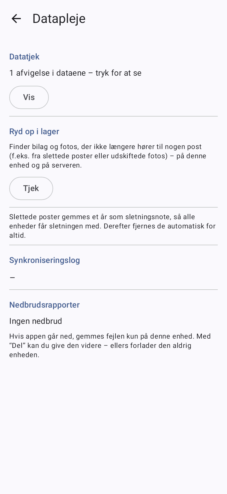

**Indstillinger → Datapleje** indeholder:

- **Datatjek**: finder tastefejl som et kilometertal, der går baglæns, mere brændstof end tanken rummer, dubletter eller en dato i fremtiden. “Det passer” skjuler et hint permanent, også på dine andre enheder.
- **Ryd op i lager**: sletter bilag og fotos, der ikke længere hører til nogen post, på enheden og på serveren. Du ser på forhånd, hvor meget plads der frigøres.
- **Synkroniseringslog**: de seneste synkroniseringer med modtagne og sendte poster.
- **Nedbrudsrapporter**: gemmes kun på enheden og gives kun videre, hvis du sender dem via “Del”.

Slettede poster gemmes et år som sletningsnote, så alle enheder får sletningen med, og fjernes derefter automatisk for altid.

 

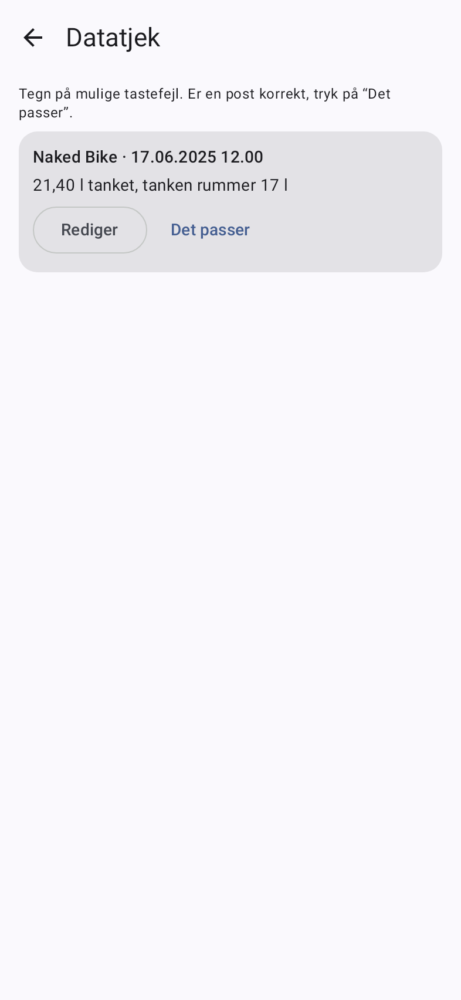

 

## Widget og genveje

- **Widget**: viser forbrug, kilometertal og brændstofpris for et køretøj på startskærmen med knapper til ny tankning eller ny omkostning. Skift køretøj med pilen.
- **Genveje**: et langt tryk på appikonet tilbyder “Tankning” og “Omkostning” direkte.

---

Privatliv: se [PRIVACY.md](../../PRIVACY.md). Spørgsmål og fejl: opret venligst et [issue på GitHub](https://github.com/RidgebackAttack/FuelAndWrench/issues).
