# Fuel & Wrench – Handbuch

[English](en.md) · [Dansk](da.md)

Alle Bilder zeigen erfundene Beispieldaten: einen Diesel-Kombi und ein Motorrad mit Saisonkennzeichen. Sie werden bei jeder neuen Version automatisch neu erzeugt.

## Inhalt

1. [Fahrzeuge](#fahrzeuge)
2. [Übersicht eines Fahrzeugs](#übersicht-eines-fahrzeugs)
3. [Tanken](#tanken)
4. [Service, HU/TÜV und Motoröl](#service-hutüv-und-motoröl)
5. [Reifen](#reifen)
6. [Kosten](#kosten)
7. [Statistik und Export](#statistik-und-export)
8. [Steckbrief](#steckbrief)
9. [Motorrad und Saisonkennzeichen](#motorrad-und-saisonkennzeichen)
10. [Erinnerungen](#erinnerungen)
11. [Spritpreise](#spritpreise)
12. [Synchronisation](#synchronisation)
13. [Datenpflege](#datenpflege)
14. [Widget und Kurzbefehle](#widget-und-kurzbefehle)

## Fahrzeuge

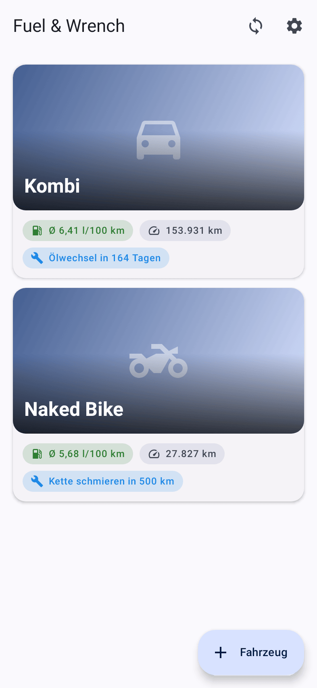

Die Startseite zeigt alle Fahrzeuge mit Verbrauch und letzter Betankung. Über **+ Fahrzeug** legst du ein neues an: Name, Fahrzeugart (Auto oder Motorrad), Kraftstoff, Tankgröße und Kilometerstand beim Start genügen. Fotos, Einheiten (km/mi, l/gal) und Währung lassen sich später ergänzen.

Ein Fahrzeug, das du nicht mehr fährst, kannst du **archivieren**: Die Daten bleiben erhalten, es taucht aber nicht mehr in Erinnerungen und Auswahllisten auf.

 

## Übersicht eines Fahrzeugs

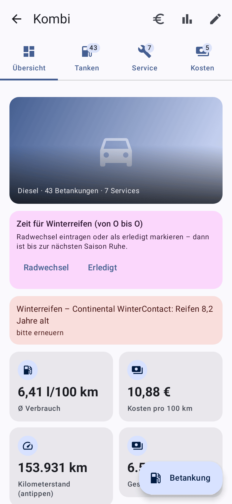

Ein Fahrzeug hat vier Reiter: **Übersicht**, **Betankungen**, **Service** und **Kosten**. Oben rechts geht es zu den Spritpreisen, zur Statistik und zum Bearbeiten.

Die Übersicht zeigt, was gerade wichtig ist:

- **Hinweise** wie Auffälligkeiten in den Daten, den fälligen Reifenwechsel („von O bis O“) oder zu alte Reifen.
- **Kennzahlen**: Durchschnittsverbrauch, Kosten pro 100 km, Kilometerstand und Gesamtkosten.
- **Erinnerungen**, z. B. Ölwechsel oder HU.

 

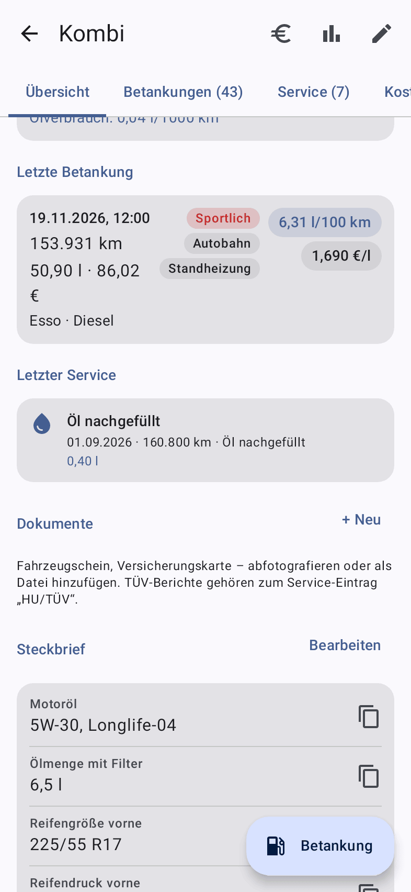

Weiter unten folgen:

- **Motoröl**: letzter Ölwechsel, seitdem nachgefülltes Öl und der Ölverbrauch. Mit **Nachfüllen** trägst du eine Nachfüllung schnell ein.
- **Dokumente**: Fahrzeugschein, Versicherungskarte, Fahrzeugbrief und der aktuelle TÜV-Bericht. Antippen öffnet die Seitenansicht.
- **Steckbrief** mit den wichtigsten Daten, siehe [Steckbrief](#steckbrief).

 

## Tanken

Über **Betankung** (unten rechts) trägst du eine Betankung ein: Kilometerstand, Menge und Preis pro Liter oder Gesamtbetrag. Der jeweils andere Wert wird ausgerechnet.

Wichtig für einen genauen Verbrauch:

- **Vollgetankt** einschalten, wenn der Tank voll ist. Teilbetankungen werden bis zur nächsten Volltankung zusammengerechnet.
- **Vorherige Betankung nicht erfasst** einschalten, wenn du eine Betankung vergessen hast. Dann wird über die Lücke nicht gemittelt.

Mit **Aktuelle Position** erkennt die App die Tankstelle. Das ist abschaltbar, siehe Datenschutz.

 

### Beleg scannen

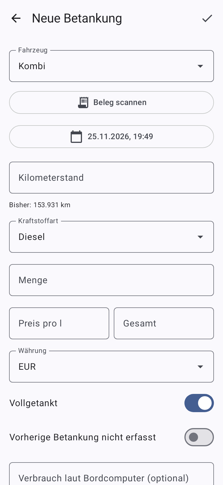

**Beleg scannen** fragt zuerst den Kilometerstand ab, der nicht auf dem Bon steht. Danach öffnet sich die Kamera. Die Texterkennung läuft vollständig auf dem Telefon und liest Menge, Preis, Betrag, Sorte, Tankstelle und Datum. Du prüfst die Werte und übernimmst sie.

Klappt es nicht auf Anhieb, kannst du den **Bereich eingrenzen**. Der Ausschnitt wird dann aus dem Originalfoto in voller Auflösung gelesen. Das hilft gerade bei Fotos aus der Hand, auf denen der Bon nur einen Teil des Bildes ausmacht.

 

### Tanken im Ausland

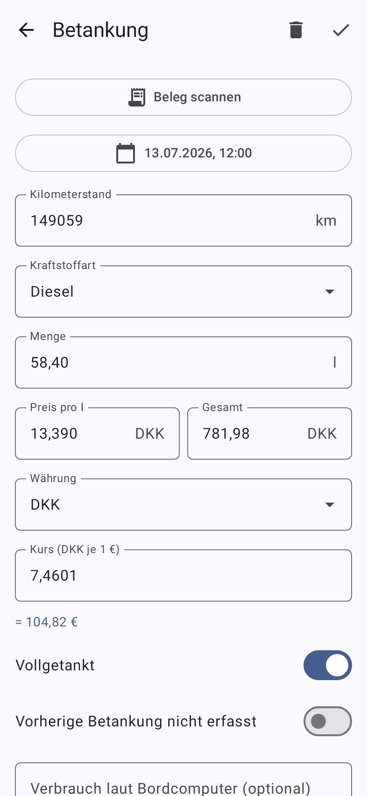

Im Feld **Währung** wählst du die Landeswährung, z. B. DKK. Preis und Betrag trägst du dann so ein, wie sie auf dem Bon stehen. Die App holt den Referenzkurs der Europäischen Zentralbank für den Tag der Betankung und zeigt den umgerechneten Betrag. Statistik und Kosten rechnen damit.

Hat deine Bank anders abgerechnet, änderst du den Kurs einfach von Hand. Der Bon-Scan erkennt die Währung, wenn sie eindeutig auf dem Bon steht (DKK, SEK, £, zł …). Steht dort nur „kr“, wählst du sie selbst.

 

### Liste der Betankungen

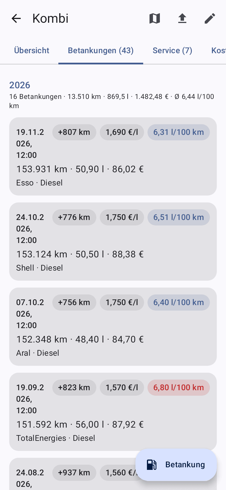

Der Reiter **Betankungen** zeigt alle Einträge nach Jahren gruppiert, mit Verbrauch und gefahrener Strecke seit der vorherigen Betankung. Antippen öffnet einen Eintrag zum Bearbeiten.

 

## Service, HU/TÜV und Motoröl

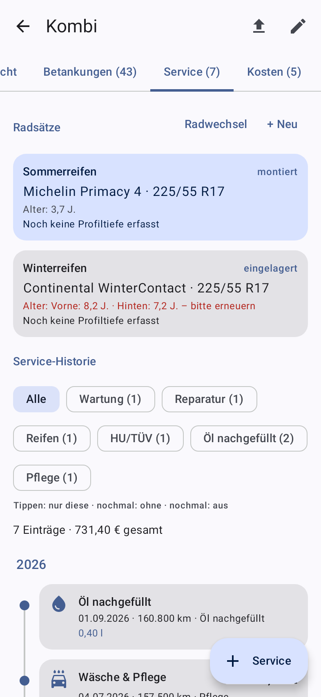

Der Reiter **Service** zeigt die Werkstatt- und Wartungshistorie. Mit den **Filtern** oben grenzt du die Liste ein:

- einmal tippen: **nur** diese Kategorie,
- nochmal tippen: **ohne** diese Kategorie (rot, durchgestrichen),
- ein drittes Mal: Filter aus.

Mehrere Kategorien lassen sich kombinieren, „Alle“ setzt den Filter zurück. Belege und Berichte erscheinen als kleine Vorschau. Antippen der Vorschau öffnet sie direkt.

 

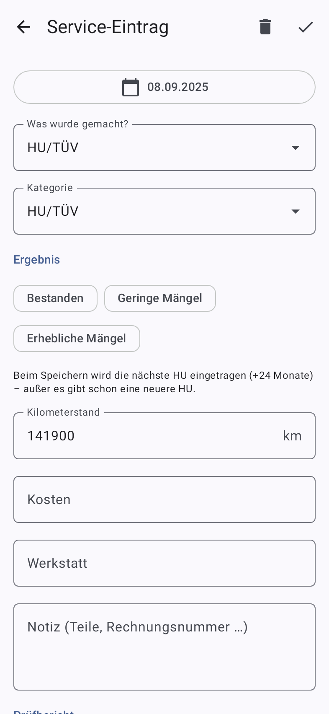

**HU/TÜV** ist eine eigene Kategorie mit **Ergebnis** (bestanden, geringe Mängel, erhebliche Mängel) und dem Prüfbericht als Anhang. Bei „bestanden“ oder „geringe Mängel“ setzt die App die nächste HU automatisch auf Prüfdatum plus 24 Monate. Bei erheblichen Mängeln bleibt die Erinnerung bis zur Nachprüfung stehen.

**Ölwechsel**: Bei Wartungseinträgen gibt es den Schalter „Ölwechsel“. Er ist die Grundlage für den Ölverbrauch. **Öl nachgefüllt** ist eine eigene Kategorie mit Menge. Am schnellsten trägst du es über die Motoröl-Karte in der Übersicht ein.

 

## Reifen

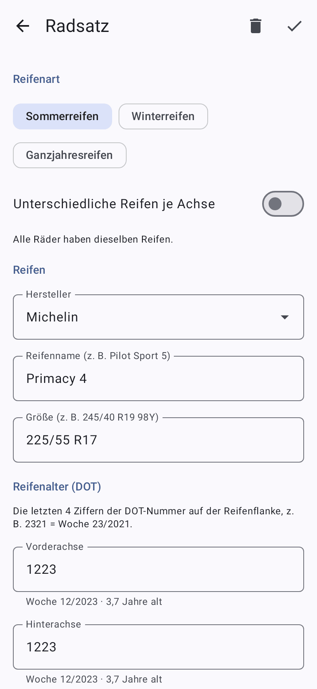

Unter **Service** verwaltest du deine Reifensätze (Sommer, Winter, Ganzjahr) mit Marke, Modell und Größe, beim Motorrad getrennt für vorne und hinten.

- **Reifenalter**: Trag die letzten 4 Ziffern der DOT-Nummer je Achse ein (z. B. 2321 = Woche 23/2021). Ab 6 Jahren erscheint ein Hinweis, ab 8 Jahren eine Warnung.
- **Radwechsel**: Ein Service-Eintrag „Radwechsel“ merkt sich, welcher Satz montiert ist, und auf Wunsch die Profiltiefe.
- **Erinnerung „von O bis O“**: Ab Oktober bzw. ab Ostern erinnert die App an den Wechsel, bis du ihn einträgst oder „Erledigt“ antippst. Das gilt nur bei zwei Sätzen und nicht bei Ganzjahresreifen.

 

## Kosten

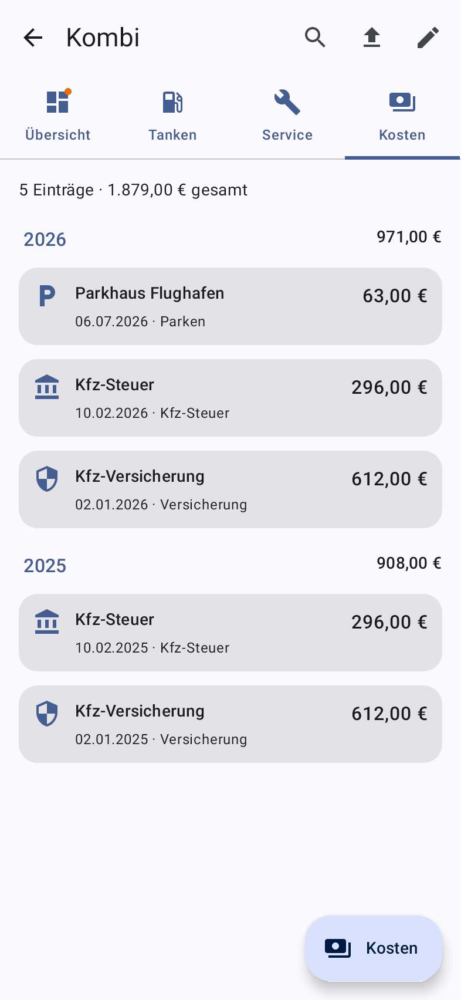

Unter **Kosten** stehen alles außer Sprit und Werkstatt: Versicherung, Steuer, Parken, Maut, Wäsche usw., jeweils mit Beleg als Foto oder PDF.

 

## Statistik und Export

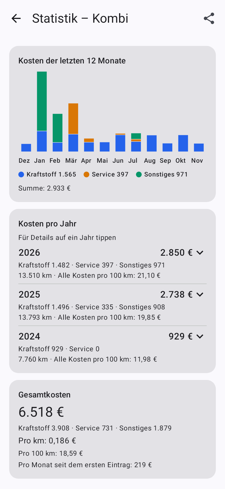

Die **Statistik** (Diagramm-Symbol oben) zeigt jedes Jahr mit Strecke, Verbrauch und Kosten. Antippen klappt die Monate auf. Darunter folgen die Verläufe von Verbrauch und Preis. Der Zeitraum der Diagramme lässt sich über die Chips wählen.

Über das **Teilen-Symbol** exportierst du Betankungen, Service und Kosten des Fahrzeugs als CSV-Dateien, z. B. für Excel.

 

**Gesamtkosten**: Was kostet das Fahrzeug wirklich? Sprit, Service und sonstige Kosten zusammen, pro km, pro 100 km und pro Monat. Weiter unten stehen die Ölnachfüllungen pro Jahr mit Ölverbrauch.

 

## Steckbrief

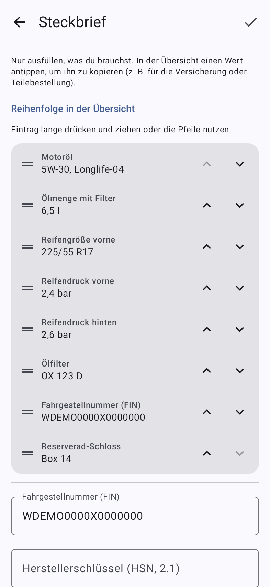

Der **Steckbrief** sammelt, was man immer wieder sucht: Fahrgestellnummer, HSN/TSN, Ölsorte und -menge, Filter, Reifengrößen und -druck, beim Motorrad auch Kette, Ritzel und Gabelöl. Eigene Felder kannst du beliebig hinzufügen.

In der Übersicht **kopiert** ein Antippen den Wert, z. B. für die Versicherung oder eine Teilebestellung. Die **Reihenfolge** legst du im Steckbrief oben fest: Eintrag lange drücken und ziehen oder die Pfeile nutzen.

 

## Motorrad und Saisonkennzeichen

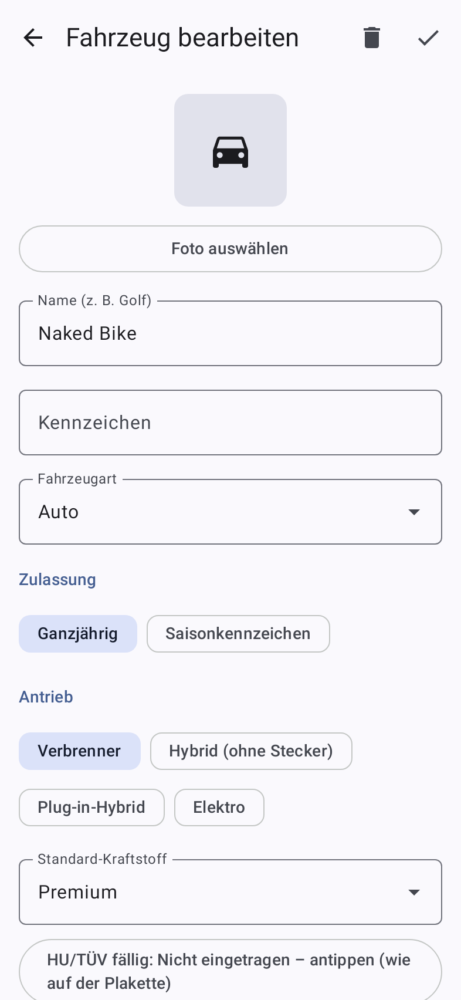

Unter **Fahrzeug bearbeiten → Zulassung** wählst du „Ganzjährig“ oder „Saisonkennzeichen“ mit Monat von und bis, z. B. März bis Oktober. Außerhalb dieses Zeitraums pausieren Benachrichtigungen und der Reifenhinweis. Was in der Pause fällig wird, meldet sich zum Saisonstart. Die Übersicht zeigt den Stand, z. B. „abgemeldet, wieder ab März“.

 

## Erinnerungen

Erinnerungen gibt es nach Kilometern, nach Zeit oder nach beidem, z. B. „Ölwechsel alle 30.000 km oder 2 Jahre“. Rechtzeitig vorher kommt eine Benachrichtigung. Ein passender Service-Eintrag (gleicher Titel) setzt die Erinnerung automatisch zurück. Die HU-Erinnerung legst du am einfachsten über **Fahrzeug bearbeiten → HU/TÜV fällig** an.

## Spritpreise

Mit einem eigenen, kostenlosen Schlüssel von Tankerkönig (Einstellungen → Spritpreise) zeigt die App die aktuellen Preise in der Nähe. Als Standort dient die aktuelle Position oder, wenn sie nicht verfügbar ist, die letzte Betankung.

**Lohnt sich der Umweg?** Bei jeder Tankstelle steht, ob sich der Weg gegenüber der nächstgelegenen lohnt. Gerechnet wird mit deiner üblichen Tankmenge, deinem Verbrauch und dem Umweg hin und zurück.

## Synchronisation

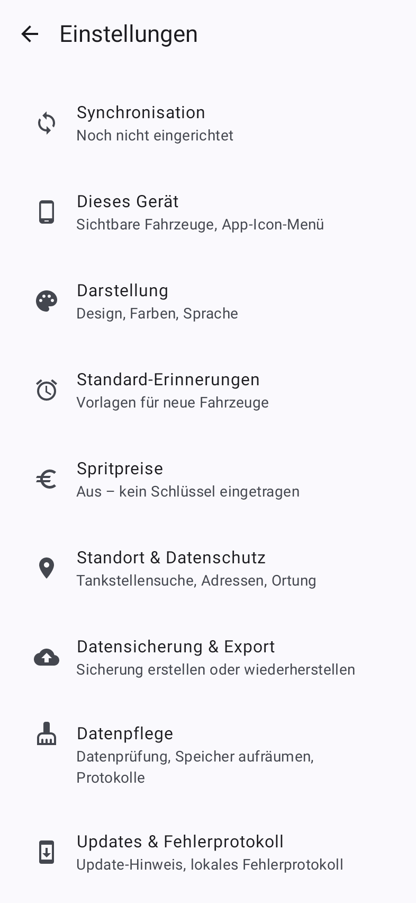

Unter **Einstellungen → Synchronisierung** verbindest du die App mit deiner eigenen Nextcloud oder einem anderen WebDAV-Server. Am besten nutzt du dafür ein App-Passwort. Alle Geräte, die denselben Ordner nutzen, haben denselben Stand, Fotos und Belege eingeschlossen.

Mit **Ende-zu-Ende-Verschlüsselung** liegen auf dem Server nur verschlüsselte Daten. Das Passwort braucht jedes Gerät, ohne Passwort sind die Daten nicht wiederherstellbar.

Steckbrief, Dokumente, Fotos, Kilometerstand und „Reifen erledigt“ werden einzeln zusammengeführt. Änderungen an unterschiedlichen Teilen auf zwei Geräten überschreiben sich also nicht.

 

## Datenpflege

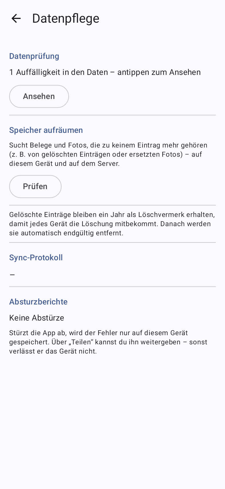

**Einstellungen → Datenpflege** enthält:

- **Datenprüfung**: Findet Tippfehler, z. B. einen rückwärts laufenden Kilometerstand, mehr Menge als in den Tank passt, doppelte Einträge oder ein Datum in der Zukunft. „Passt so“ blendet einen Hinweis dauerhaft aus, auch auf deinen anderen Geräten.
- **Speicher aufräumen**: Löscht Belege und Fotos, die zu keinem Eintrag mehr gehören, auf dem Gerät und auf dem Server. Vorher siehst du, wie viel Platz frei wird.
- **Sync-Protokoll**: Die letzten Synchronisationen mit empfangenen und gesendeten Einträgen.
- **Absturzberichte**: Werden nur auf dem Gerät gespeichert. Weitergegeben werden sie nur, wenn du sie über „Teilen“ verschickst.

Gelöschte Einträge bleiben ein Jahr lang als Löschvermerk erhalten, damit jedes Gerät die Löschung mitbekommt, und werden danach automatisch endgültig entfernt.

 

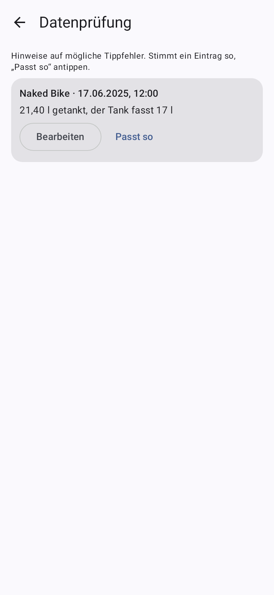

 

## Widget und Kurzbefehle

- **Widget**: Zeigt Verbrauch, Kilometerstand und Spritpreis eines Fahrzeugs auf dem Homescreen und hat Knöpfe für eine neue Betankung oder neue Kosten. Mehrere Fahrzeuge blätterst du mit dem Pfeil durch.
- **Kurzbefehle**: Ein langer Druck auf das App-Symbol bietet „Betankung“ und „Kosten“ direkt an.

---

Datenschutz: siehe [PRIVACY.md](../../PRIVACY.md). Fragen und Fehler bitte als [Issue auf GitHub](https://github.com/RidgebackAttack/FuelAndWrench/issues).
