# Fuel & Wrench – User manual

[Deutsch](de.md) · [Dansk](da.md)

All pictures show made-up sample data: a diesel estate car and a motorcycle with seasonal registration. They are generated automatically for every new version.

## Contents

1. [Vehicles](#vehicles)
2. [Vehicle overview](#vehicle-overview)
3. [Refuelling](#refuelling)
4. [Service, inspection and engine oil](#service-inspection-and-engine-oil)
5. [Tires](#tires)
6. [Costs](#costs)
7. [Statistics and export](#statistics-and-export)
8. [Data sheet](#data-sheet)
9. [Motorcycle and seasonal registration](#motorcycle-and-seasonal-registration)
10. [Reminders](#reminders)
11. [Fuel prices](#fuel-prices)
12. [Sync](#sync)
13. [Data care](#data-care)
14. [Widget and shortcuts](#widget-and-shortcuts)

## Vehicles

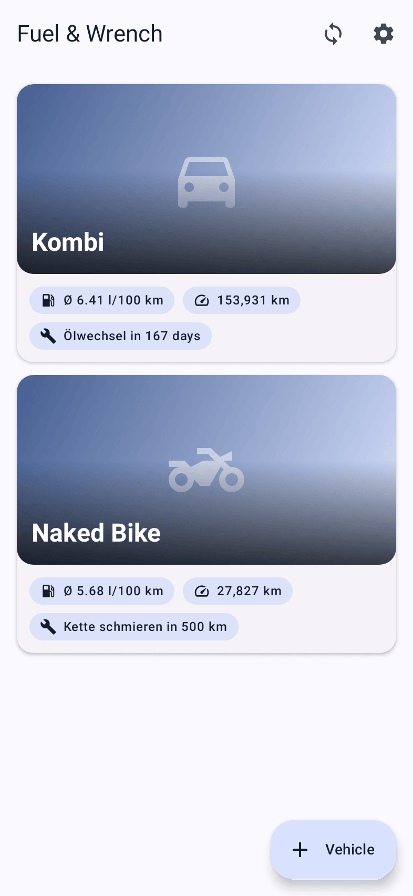

The start page lists all vehicles with consumption and last refuel. Tap **+ Vehicle** to add one: name, type (car or motorcycle), fuel, tank size and starting odometer are enough. Photos, units (km/mi, l/gal) and currency can be added later.

A vehicle you no longer drive can be **archived**: its data stays, but it no longer shows up in reminders and pickers.

 

## Vehicle overview

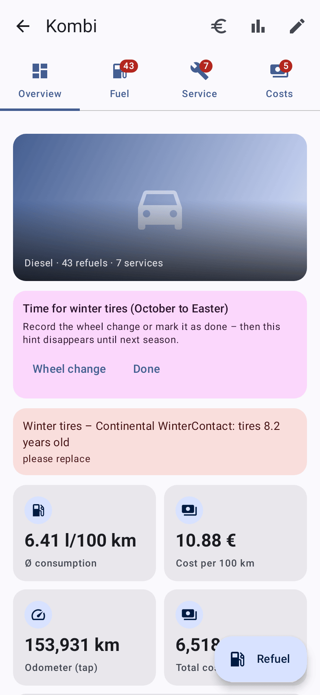

A vehicle has four tabs: **Overview**, **Refuels**, **Service** and **Costs**. The icons at the top lead to fuel prices, statistics and editing.

The overview shows what matters right now:

- **Hints** such as issues in the data, the due tire change (October to Easter) or tires that are too old.
- **Key figures**: average consumption, cost per 100 km, odometer and total cost.
- **Reminders**, e.g. oil change or inspection.

 

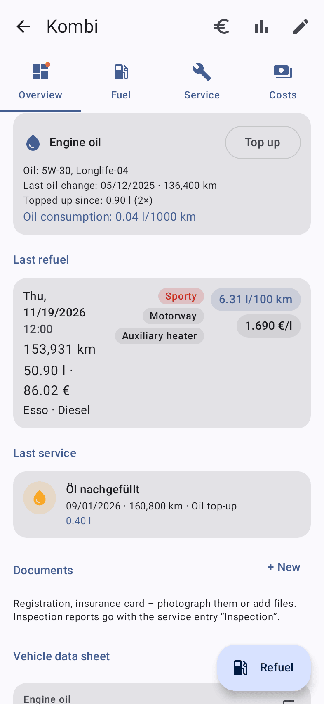

Further down:

- **Engine oil**: last oil change, oil topped up since and oil consumption. **Top up** records a top-up quickly.
- **Documents**: registration, insurance card, title and the current inspection report. Tap to open the page viewer.
- **Data sheet** with the most important details, see [Data sheet](#data-sheet).

 

## Refuelling

Tap **Refuel** (bottom right) to record a refuel: odometer, amount and either price per litre or total. The other value is calculated.

For accurate consumption:

- Turn on **Full tank** when the tank is full. Partial refuels are added up until the next full one.
- Turn on **Previous refuel not recorded** if you forgot one, so the gap is not averaged.

**Current position** recognises the fuel station. This can be switched off, see privacy.

 

### Scanning a receipt

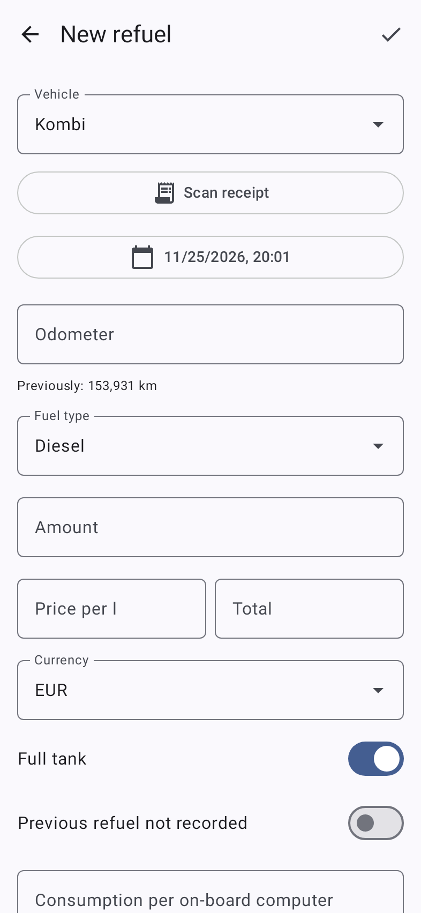

**Scan receipt** first asks for the odometer, which is not on the receipt, then opens the camera. Text recognition runs entirely on the phone and reads amount, price, total, fuel type, station and date. You check the values and apply them.

If it doesn't work right away, **narrow the area**. The selected part is then read from the original photo at full resolution, which helps especially with hand-held photos where the receipt fills only part of the picture.

 

### Refuelling abroad

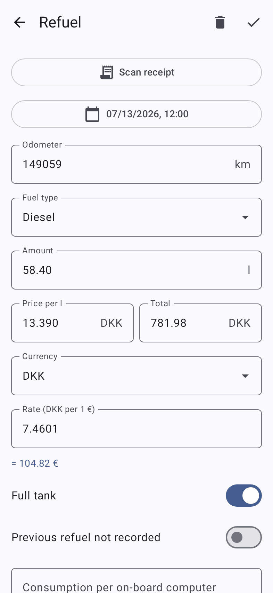

Choose the local **currency**, e.g. DKK, and enter price and total as printed on the receipt. The app fetches the European Central Bank reference rate for the day of the refuel and shows the converted amount. Statistics and costs use that.

If your bank charged a different rate, simply change it. The receipt scan detects the currency when it is clear from the receipt (DKK, SEK, £, zł …). If it only says “kr”, choose it yourself.

 

### Refuel list

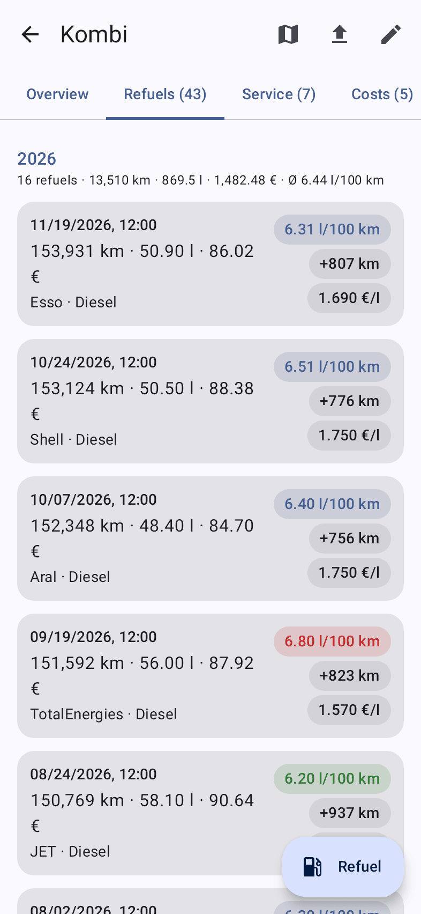

The **Refuels** tab lists all entries grouped by year, with consumption and distance since the previous refuel. Tap an entry to edit it.

 

## Service, inspection and engine oil

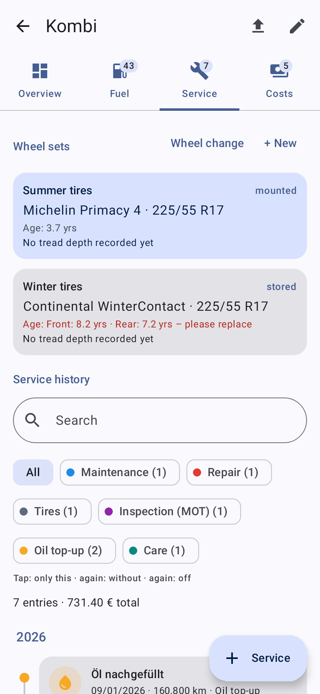

The **Service** tab shows the workshop and maintenance history. Use the **filters** at the top:

- tap once: **only** this category,
- tap again: **without** this category (red, struck through),
- tap a third time: filter off.

You can combine categories, “All” resets the filter. Receipts and reports appear as small previews; tap a preview to open it directly.

 

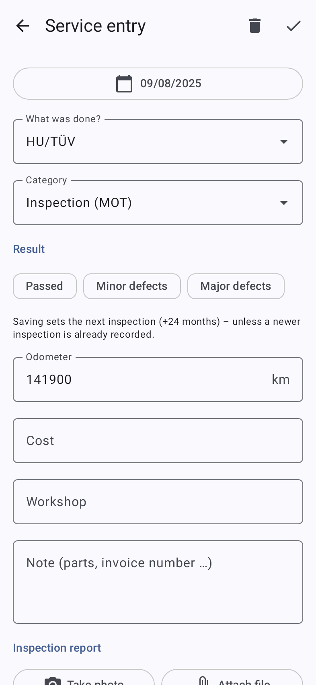

**Inspection (MOT)** is its own category with a **result** (passed, minor defects, major defects) and the report as attachment. With “passed” or “minor defects”, the next inspection is set automatically to inspection date plus 24 months. With major defects the reminder stays until the re-inspection.

**Oil change**: maintenance entries have an “Oil change” switch, which is the basis for oil consumption. **Oil top-up** is its own category with amount. The quickest way is the engine oil card in the overview.

 

## Tires

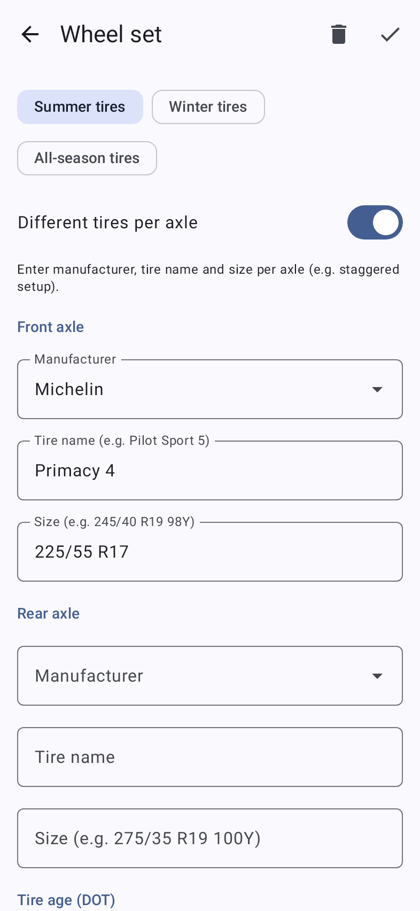

Under **Service** you manage tire sets (summer, winter, all-season) with brand, model and size, separately for front and rear on a motorcycle.

- **Tire age**: enter the last 4 digits of the DOT number per axle (e.g. 2321 = week 23/2021). A hint appears from 6 years, a warning from 8 years.
- **Wheel change**: a service entry “Wheel change” remembers which set is fitted and, if you like, the tread depth.
- **Seasonal reminder**: from October and from Easter the app reminds you of the change until you record it or tap “Done”. This applies only with two sets and not to all-season tires.

 

## Costs

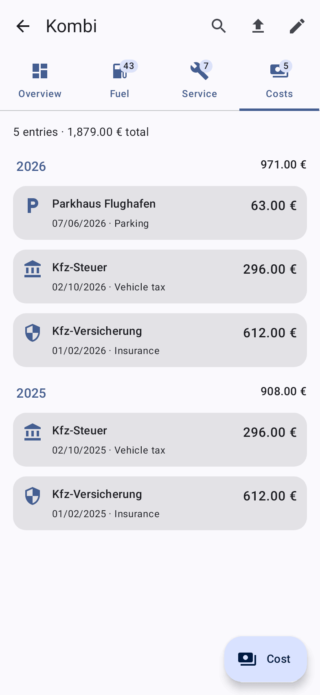

**Costs** holds everything except fuel and workshop: insurance, tax, parking, tolls, car wash and so on, each with a receipt as photo or PDF.

 

## Statistics and export

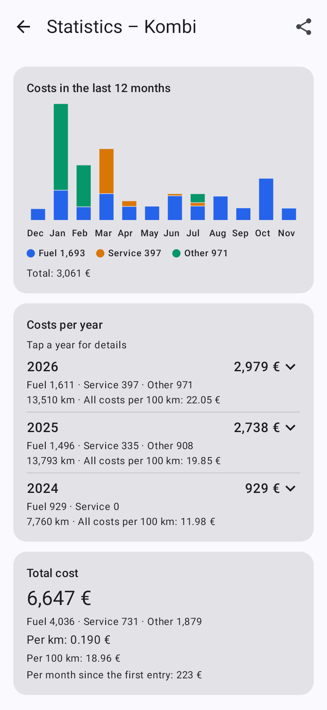

**Statistics** (chart icon at the top) shows each year with distance, consumption and cost; tap a year to see the months. Below are the consumption and price charts, whose period you choose with the chips.

The **share icon** exports refuels, service and costs of the vehicle as CSV files, e.g. for Excel.

 

**Total cost**: what does the vehicle really cost? Fuel, service and other costs together, per km, per 100 km and per month. Further down are the oil top-ups per year with oil consumption.

 

## Data sheet

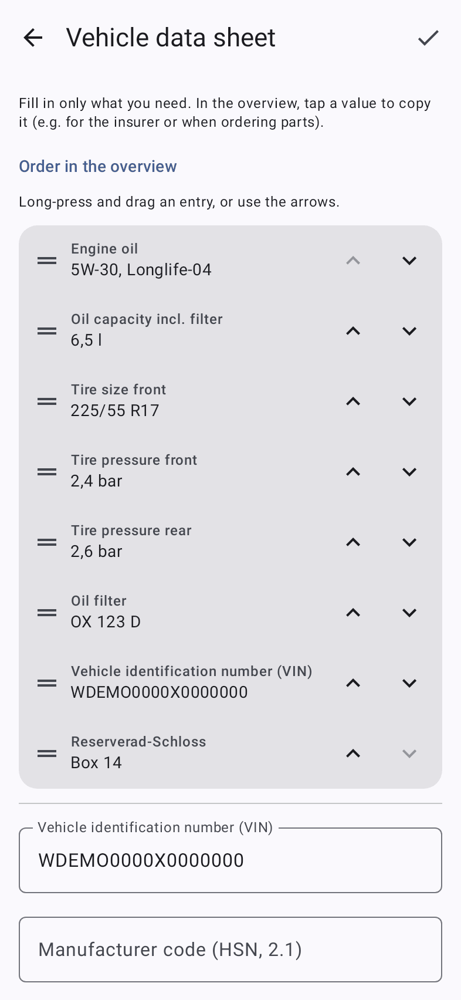

The **data sheet** collects what you keep looking for: VIN, manufacturer and type codes, oil type and capacity, filters, tire sizes and pressures, and on a motorcycle also chain, sprockets and fork oil. Add any custom fields you need.

In the overview, a tap **copies** the value, e.g. for the insurer or when ordering parts. Set the **order** at the top of the data sheet: long-press and drag an entry, or use the arrows.

 

## Motorcycle and seasonal registration

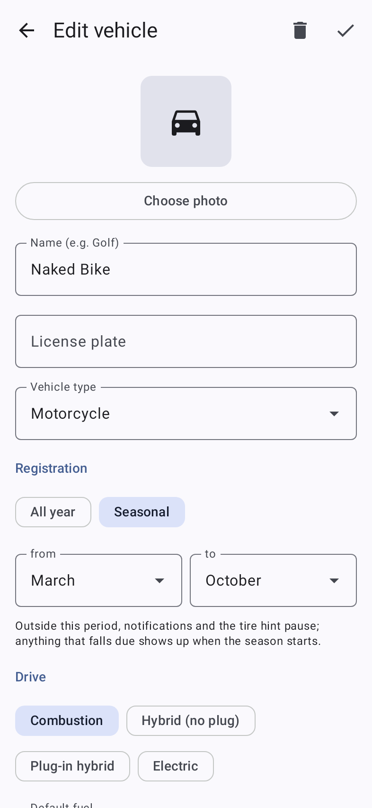

Under **Edit vehicle → Registration**, choose “All year” or “Seasonal” with a month range, e.g. March to October. Outside that period, notifications and the tire hint pause; anything that falls due shows up when the season starts. The overview shows the state, e.g. “off the road, back from March”.

 

## Reminders

Reminders work by distance, by time or both, e.g. “oil change every 30,000 km or 2 years”. A notification comes in good time beforehand. A matching service entry (same title) resets the reminder automatically. The inspection reminder is easiest to set via **Edit vehicle → Inspection due**.

## Fuel prices

With your own free key from Tankerkönig (Germany only; Settings → Fuel prices), the app shows current prices nearby, based on your current position or, if that is not available, the last refuel.

**Worth the detour?** Each station shows whether the trip pays off compared to the nearest one, based on your usual fill, your consumption and the detour there and back.

## Sync

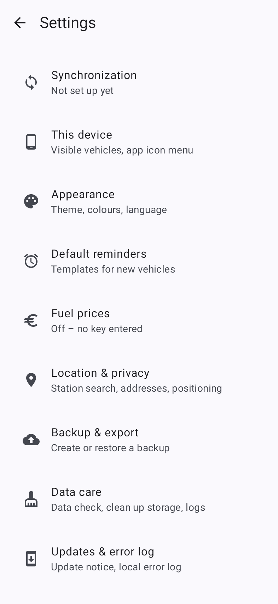

Under **Settings → Synchronization** you connect the app to your own Nextcloud or another WebDAV server, ideally with an app password. All devices using the same folder share the same data, including photos and receipts.

With **end-to-end encryption**, only encrypted data is stored on the server. Every device needs the password; without it the data cannot be recovered.

Data sheet, documents, photos, odometer and “tires done” are merged separately, so changes to different parts on two devices don't overwrite each other.

 

## Data care

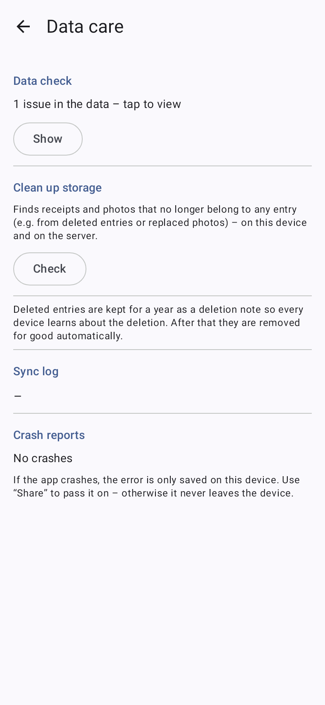

**Settings → Data care** contains:

- **Data check**: finds typos such as an odometer going backwards, more fuel than the tank holds, duplicates or a date in the future. “It's fine” hides a hint permanently, on your other devices too.
- **Clean up storage**: deletes receipts and photos that no longer belong to any entry, on the device and on the server. You see beforehand how much space it frees.
- **Sync log**: the latest syncs with received and sent entries.
- **Crash reports**: stored only on the device and passed on only if you send them via “Share”.

Deleted entries are kept for a year as a deletion note so every device learns about the deletion, and are then removed for good automatically.

 

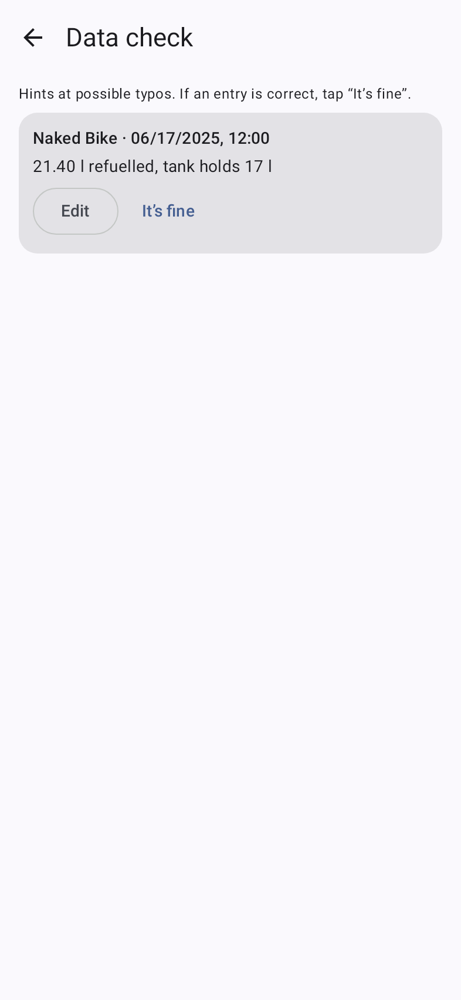

 

## Widget and shortcuts

- **Widget**: shows consumption, odometer and fuel price of a vehicle on the home screen, with buttons for a new refuel or new cost. Use the arrow to switch between vehicles.
- **Shortcuts**: a long press on the app icon offers “Refuel” and “Cost” directly.

---

Privacy: see [PRIVACY.md](../../PRIVACY.md). Questions and bugs: please open an [issue on GitHub](https://github.com/RidgebackAttack/FuelAndWrench/issues).
